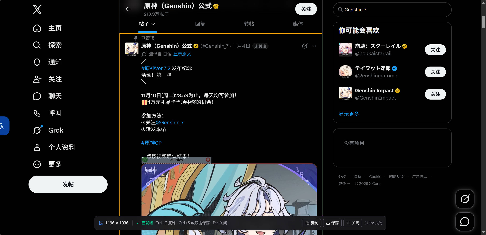
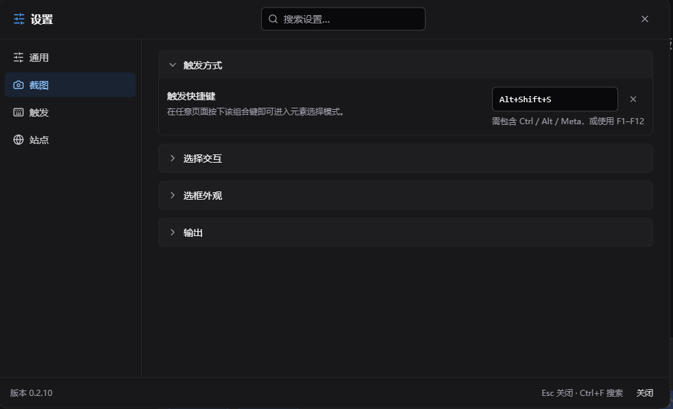
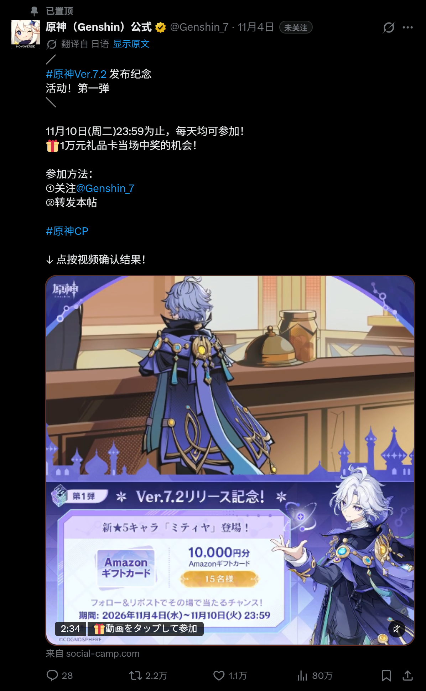
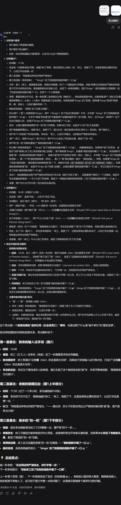

# Element Screenshot

Capture any element on a web page — including everything hidden inside its scrollable area — as one complete long image.

> [!IMPORTANT]
> **AI-generated code notice**
>
> The code in this project was generated by AI; tests and documentation were also AI-assisted. The result was reviewed, tested and verified in real browsers by a human. Understand what the script does before using it on pages with sensitive information. Captures are processed locally and are never uploaded.

[简体中文](README.md) · [English](README.en.md)

## Features

- **Complete long captures** — expand the target's internal scroll containers automatically, so content outside the viewport is included instead of stitching screenshots one screen at a time.
- **Any element or the whole page** — hover to preview, use the wheel or `+` / `-` to walk the element stack, and press `Ctrl+A` to capture the full page.
- **Drag a region** — press and drag a rectangle over the page; on release that exact region is captured, with every scrolled pane restored at its own scroll offset, plus sticky headers and fixed overlays as you see them.
- **What you select is what you get** — the selection frame covers the element's complete scroll range, and the output matches that box rather than only the visible viewport.
- **High-resolution export** — export at 1× / 2× / 3×. Very large pages are downscaled automatically when they exceed the browser's canvas limits.
- **Faithful backgrounds** — solid colors, gradients, background images and dark themes are preserved; transparent regions no longer default to white.
- **Leaves the page alone** — an interaction shield prevents hover/click effects from leaking into the capture; the UI lives in Shadow DOM; page styles and scroll positions are restored afterwards.
- **Configurable** — shortcut, border color/width, floating button, site rules, page/custom/transparent background, three UI languages and light/dark themes.
- **Local processing** — screenshots are not uploaded. Cross-origin images and fonts are requested through the userscript manager only when they need to be inlined.

## Screenshots

<table>
  <tr>
    <td width="50%" valign="top">
      <details open>
        <summary><b>Element picker</b></summary>
        <br><sub>Pick any element and switch layers with the wheel</sub>
      </details>
    </td>
    <td width="50%" valign="top">
      <details>
        <summary><b>Settings</b></summary>
        <br><sub>Shortcut, background mode, site rules and three languages</sub>
      </details>
    </td>
  </tr>
  <tr>
    <td width="50%" valign="top">
      <details>
        <summary><b>X post</b></summary>
        <br><sub>Social post: text, images and action bar captured together</sub>
      </details>
    </td>
    <td width="50%" valign="top">
      <details>
        <summary><b>DeepSeek conversation</b></summary>
        <br><sub>AI chat: an entire answer saved as one image</sub>
      </details>
    </td>
  </tr>
</table>

## Install

| Source          | Install                                                                |
| --------------- | ---------------------------------------------------------------------- |
| GitHub Releases | [Download the latest release](../../releases/latest)                   |
| Greasyfork      | [greasyfork.org/scripts/604334](https://greasyfork.org/scripts/604334) |

After installing, refresh the target page. A camera floating button appears near the bottom-right corner. You can also press `Alt+Shift+S` or use the userscript menu → “Capture element”.

## Usage

### Start a capture

- Click the camera floating button;
- press `Alt+Shift+S` (configurable);
- or use the userscript menu → “Capture element”.

### Pick an element

| Action                 | Result                                 |
| ---------------------- | -------------------------------------- |
| Move the mouse         | Preview the element under the cursor   |
| Wheel down / `+` / `↓` | Select a more deeply nested element    |
| Wheel up / `-` / `↑`   | Select an outer element                |
| Click / `Enter`        | Confirm and start rendering            |
| Press and drag (4px+)  | Select a rectangle; release to capture |
| `Ctrl+A` / `Cmd+A`     | Capture the whole page                 |
| `Esc`                  | Cancel                                 |

After selection:

| Action                | Result                           |
| --------------------- | -------------------------------- |
| `Ctrl+C` / `Cmd+C`    | Copy the PNG to the clipboard    |
| `Ctrl+S` / `Cmd+S`    | Save the PNG (file picker first) |
| Double-click the page | Save the PNG                     |
| `Esc`                 | Close the result UI              |

> “Isolate page interaction” is on by default. While picking, the page receives no hover, click or mousemove events, so temporary hover styles do not appear in the image. Turn it off in Settings → Capture → Picker interaction to capture a hover state.
>
> Clipboard access needs browser permission. The file picker is Chromium-only; other browsers fall back to a normal download.

### Settings

- **Trigger** — shortcut, floating button visibility/size and dragged position.
- **Capture** — export scale, page/custom/transparent background, expand nested scroll areas, picker interaction isolation.
- **Appearance** — border color and width, UI language (简体中文 / 繁體中文 / English), light/dark theme.
- **Site rules** — only run on, or exclude, specific sites. Excluded pages can still be enabled temporarily from the userscript menu.

## Known limitations

- Closed Shadow DOM cannot be picked. Open Shadow DOM can be picked, but its contents may not be fully included in the render.
- Cross-origin iframes cannot be picked. Video, WebGL and canvas content depends on the current pixels and may be blank.
- Very large pages are downscaled automatically when they exceed browser canvas limits.
- Region capture is limited to the current viewport; scroll to the target before dragging.
- Every scrolled container inside the region costs one more render: a few seconds for a single pane, and 10–15 seconds for four in our measurements.
- Inside a scrolled pane, pseudo-element overlays, `mix-blend-mode`, and descendants positioned outside the pane's clip may differ slightly from the page.
- `position: sticky/fixed` elements in full-page captures are handled against the renderer's viewport and may differ from a manually stitched capture.
- Cross-origin fonts can only be inlined when the stylesheet is readable; otherwise they fall back to system fonts.
- Interaction isolation suppresses hover by default; turn it off when a hover state is required.
- Complex backgrounds currently cover gradients and background images on `html` / `body`; pseudo-elements, masks and all fixed/absolute layers may still differ.

## Development

Requires Node.js >= 22.12 and pnpm 10.

```bash
pnpm install
pnpm playground     # local test page at http://127.0.0.1:4176/
pnpm dev:settings   # settings library demo
pnpm check          # lint + typecheck + coverage + build
```

Run `pnpm check` before committing. See [AGENTS.md](AGENTS.md) for the real-browser and MCP debugging workflow.

### Layout

```text
packages/userscript/   userscript: capture, picker, background, native API snapshot, UI
packages/settings/     reusable settings library: schema, storage, i18n, Vue components
packages/userscript/src/plugin/
                       Vite plugin wiring html-to-image fetch/XHR to the GM adapter
playground/            local acceptance pages and a GM stub
```

The capture pipeline is: pick element → measure its full box → expand internal scroll containers → resolve the backdrop → clone and inline resources with html-to-image → sanitize XML/SVG → export a PNG through canvas. The script snapshots native browser APIs at `document-start` so page hooks are less likely to interfere.

Region capture takes a different route: every scrolled container that intersects the region is rendered once as its own "current scroll view", painted back as that container's background layer, and the page is rendered once more before cropping — no descendant ever gets repositioned.

Common traps:

- html-to-image clones only the target subtree; SVG, backgrounds and CSS variables that depend on themed ancestors need extra handling.
- Do not assume `document.elementsFromPoint()` returns `body`; tall elements also need viewport-clipping handling.
- Cross-origin canvas/video content can taint the canvas; always provide a `SecurityError` fallback.
- Background tabs may not run `requestAnimationFrame`; frame waits need a timer fallback.
- Do not commit `dist/` or `coverage/`; build artifacts come from a local `pnpm build`.

## Acknowledgements

- [DeepSeek Harness](https://github.com/deepseek-ai/deepseek-harness) — an open-source, easy-to-use harness that is highly customizable.
- [Violentmonkey](https://violentmonkey.github.io/) and [Violentmonkey MCP](https://github.com/violentmonkey/mcp) — an open-source, easy-to-use userscript manager with AI-assisted development.
- [html-to-image](https://github.com/bubkoo/html-to-image) — precise yet elegant screenshot rendering infrastructure.
- [Playwright](https://playwright.dev/), [Vitest](https://vitest.dev/), [ESLint](https://eslint.org/), [TypeScript](https://www.typescriptlang.org/) and [Git](https://git-scm.com/) — a high-quality development toolchain.
- [Vue 3](https://vuejs.org/) and [Tailwind CSS](https://tailwindcss.com/) — a modern UI framework.

## License

[MIT](LICENSE). See [CHANGELOG.md](CHANGELOG.md) for versions and changes.
