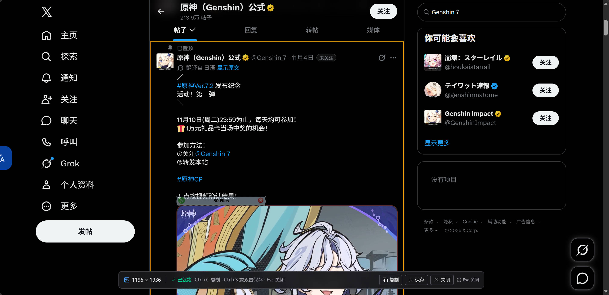
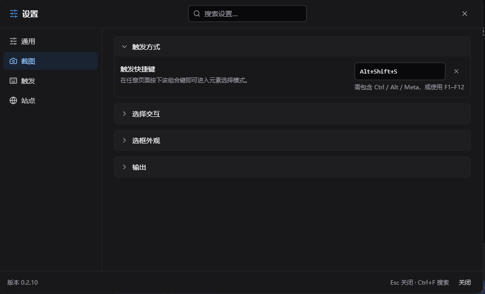
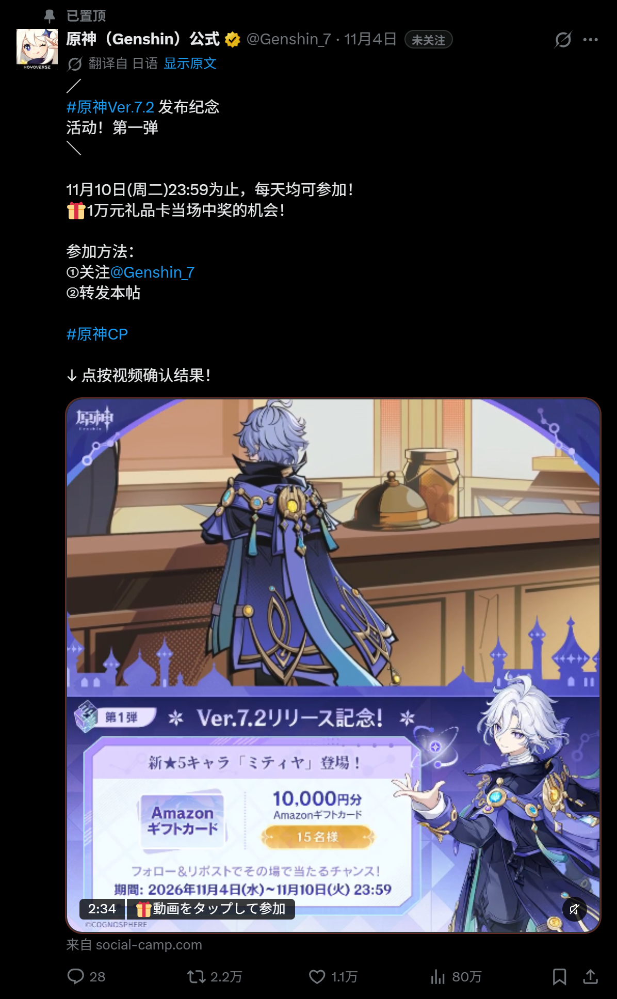
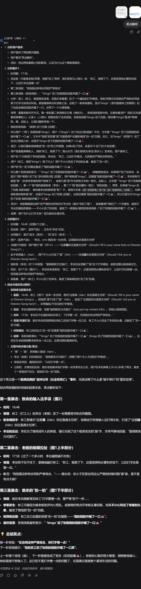

# 网页元素截图 Element Shot

一键把网页上的任意元素，连同它被滚动隐藏的内容，完整保存成一张长图。

> [!IMPORTANT]
> **AI 生成代码声明**
>
> 本项目的代码由 AI 生成，测试和文档也由 AI 参与生成，并经过人工审阅、自动化测试和真实浏览器验证。请在理解脚本行为后再用于包含敏感信息的页面；截图只在本机完成，不会上传。

[简体中文](README.md) · [English](README.en.md)

## 功能

- **完整长截图**：选中元素后自动展开它内部的滚动区域，把屏幕外被裁掉的内容一起截进来，不需要一屏一屏拼接。
- **任意元素或整页**：鼠标悬停即可预选；滚轮或 `+` / `-` 在层叠元素之间切换；`Ctrl+A` 直接截整页。
- **所见即所得**：选框按元素的完整滚动范围绘制，截图尺寸与最终 PNG 对应，不会只截到当前视口。
- **高清导出**：支持 1× / 2× / 3× 倍率；超出浏览器 canvas 上限时自动降采样，避免整次截图失败。
- **复杂背景还原**：保留页面纯色、渐变、背景图以及深色主题，不会把透明区域统一填成白色。
- **不干扰页面**：选择时用透明层隔离页面交互；UI 放在 Shadow DOM 中；截图结束后恢复页面样式与滚动位置。
- **可配置**：快捷键、选框颜色/粗细、悬浮按钮、站点运行策略、跟随页面背景/自定义背景/透明背景、三语界面和明暗主题。
- **本地处理**：截图不上传；只有内联跨域图片、字体等资源时，才会通过脚本管理器向资源原始地址发起请求。

## 效果

<table>
  <tr>
    <td width="50%" valign="top">
      <details open>
        <summary><b>元素选择器</b></summary>
        <br><sub>选择任意元素，滚轮切换层叠层级</sub>
      </details>
    </td>
    <td width="50%" valign="top">
      <details>
        <summary><b>设置面板</b></summary>
        <br><sub>快捷键、背景模式、站点策略和三语界面</sub>
      </details>
    </td>
  </tr>
  <tr>
    <td width="50%" valign="top">
      <details>
        <summary><b>X 帖子</b></summary>
        <br><sub>社交长帖：正文、图片与互动栏一起截取</sub>
      </details>
    </td>
    <td width="50%" valign="top">
      <details>
        <summary><b>DeepSeek 对话</b></summary>
        <br><sub>AI 长对话：整段回答完整保存为长图</sub>
      </details>
    </td>
  </tr>
</table>

## 安装

<!-- TODO: Greasyfork 发布后将“即将上线”替换为脚本安装链接。 -->

| 安装源          | 安装方式                                  |
| --------------- | ----------------------------------------- |
| GitHub Releases | [下载最新 Release](../../releases/latest) |
| Greasyfork      | 即将上线                                  |

安装后刷新目标页面，右下角会出现相机悬浮按钮。也可以按默认快捷键 `Alt+Shift+S`，或从脚本菜单选择「截图元素」。

## 使用

### 触发

- 点击页面右下角的相机悬浮按钮；
- 按 `Alt+Shift+S`（可在设置中修改）；
- 或使用脚本菜单「截图元素」。

### 选择

| 操作                 | 效果             |
| -------------------- | ---------------- |
| 移动鼠标             | 预选鼠标下的元素 |
| 滚轮向下 / `+` / `↓` | 选择更内层元素   |
| 滚轮向上 / `-` / `↑` | 选择外层元素     |
| 单击 / `Enter`       | 确认并开始截图   |
| `Ctrl+A` / `Cmd+A`   | 截取整页         |
| `Esc`                | 取消             |

选中后：

| 操作               | 效果                       |
| ------------------ | -------------------------- |
| `Ctrl+C` / `Cmd+C` | 复制 PNG 到剪贴板          |
| `Ctrl+S` / `Cmd+S` | 保存 PNG（优先文件选择器） |
| 双击页面           | 保存 PNG                   |
| `Esc`              | 关闭结果界面               |

> 默认开启「隔离页面交互」：选择时页面收不到 hover、点击和 mousemove，截图中不会出现临时 hover 样式。需要截取 hover 状态时，在设置 → 截图 → 选择交互中关闭。
>
> 剪贴板需要浏览器授权；文件选择器仅 Chromium 支持，其他浏览器自动回退为普通下载。

### 设置

- **触发**：快捷键、悬浮按钮显示/尺寸、拖动位置。
- **截图**：导出倍率、跟随页面背景/自定义颜色/透明背景、展开内部滚动区域、选择交互隔离。
- **外观**：选框颜色、边框粗细、界面语言（简体中文 / 繁體中文 / English）、明暗主题。
- **站点策略**：仅在指定网站运行，或排除指定网站；被排除的页面仍可从脚本菜单临时启用。

## 已知限制

- Closed Shadow DOM 内部无法点选；Open Shadow DOM 可以选中，但内部内容可能无法完整进入截图。
- 跨域 iframe 内部不可选；视频、WebGL/Canvas 内容依赖当前像素，可能为空白。
- 超大页面会按浏览器 canvas 上限自动降低导出倍率。
- 整页截图中的 `position: sticky/fixed` 元素按渲染器视口处理，可能与逐屏拼接结果不同。
- 跨域字体能否内联取决于样式表是否可读；不可读时会回退为系统字体。
- 默认开启的交互隔离会抑制 hover 效果；需要截 hover 状态时请关闭该开关。
- 复杂背景目前覆盖 `html` / `body` 的渐变和背景图；伪元素、mask 和所有 fixed/absolute 图层仍可能有差异。

## 开发

要求 Node.js >= 22.12、pnpm 10。

```bash
pnpm install
pnpm playground     # http://127.0.0.1:4176/，本地测试页
pnpm dev:settings   # 设置库演示页
pnpm check          # lint + typecheck + coverage + build
```

提交前至少运行 `pnpm check`。真实页面验证和 MCP 调试流程见 [AGENTS.md](AGENTS.md)。

### 结构

```text
packages/userscript/   用户脚本：截图、选择器、背景、原生 API 快照、UI
packages/settings/     独立设置库：schema、存储、i18n、Vue 组件
packages/userscript/src/plugin/
                       Vite 插件：把 html-to-image 的 fetch/XHR 接到 GM 适配器
playground/            本地验收页与 GM 桩
```

截图核心链路是：选择元素 → 计算完整范围 → 展开内部滚动容器 → 解析背景 → html-to-image 克隆/内联资源 → 清理 XML/SVG → canvas 导出 PNG。脚本在 `document-start` 保存一份原生 API 快照，尽量避免页面 Hook 干扰截图链路。

几个容易踩的坑：

- html-to-image 只克隆目标子树；依赖祖先主题变量的 SVG、背景和 CSS 变量需要额外处理。
- 背景取色不能假设 `document.elementsFromPoint()` 会返回 `body`；高元素还要处理视口裁剪。
- 跨域 canvas/video 可能污染画布，必须为 `SecurityError` 准备降级路径。
- 后台标签页可能不执行 `requestAnimationFrame`，等待帧要有定时器兜底。
- 不要提交 `dist/`、`coverage/`；构建产物由本地 `pnpm build` 生成。

## 致谢

- [html-to-image](https://github.com/bubkoo/html-to-image)：DOM 克隆与 SVG 栅格化。
- [Vue 3](https://vuejs.org/)、[Tailwind CSS](https://tailwindcss.com/)：设置面板与界面。
- [Vite](https://vite.dev/)、[vite-plugin-monkey](https://github.com/lisonge/vite-plugin-monkey)：构建与 userscript 打包。
- [Vitest](https://vitest.dev/)、[ESLint](https://eslint.org/)、[Prettier](https://prettier.io/)：测试与代码质量。
- [pnpm](https://pnpm.io/)：workspace 与依赖管理。
- 开发与验证过程中使用了 DeepSeek Harness、Playwright MCP 和 Violentmonkey MCP。

## 许可

[MIT](LICENSE)。版本与变更记录见 [CHANGELOG.md](CHANGELOG.md)。
