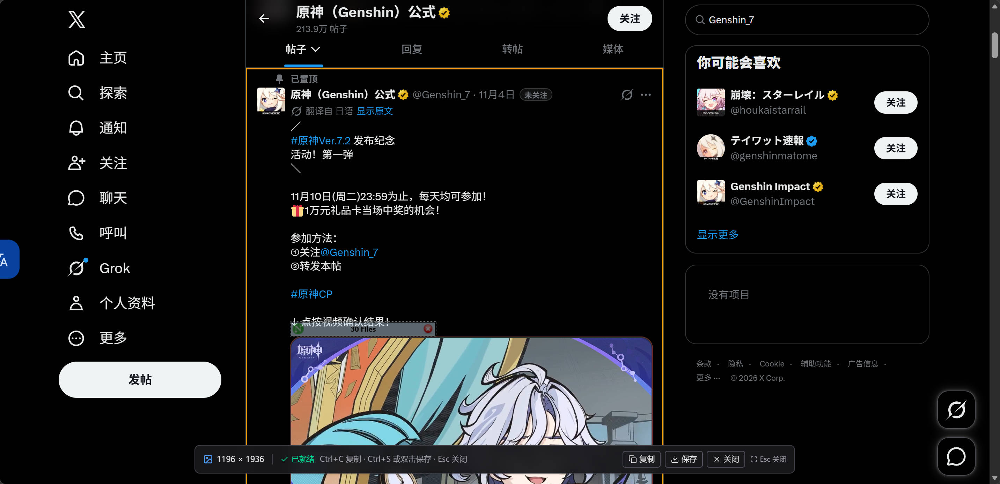
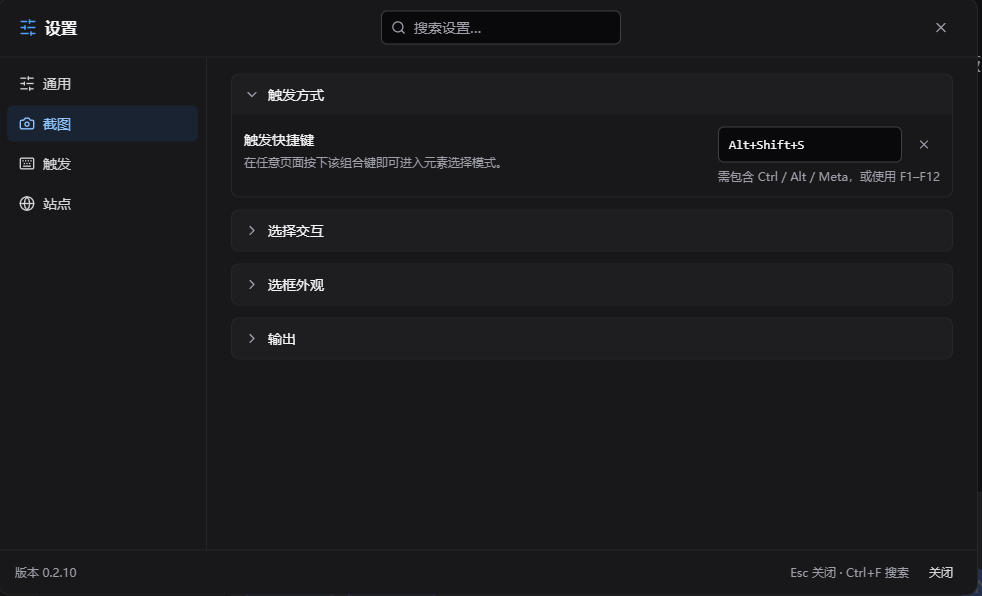
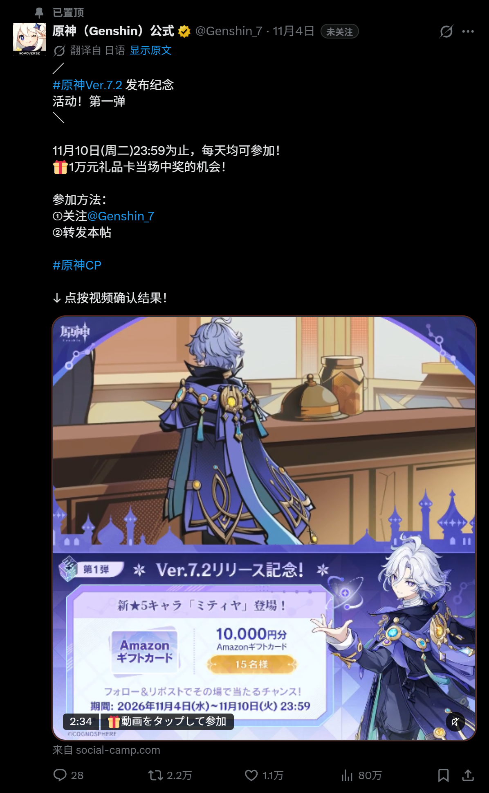
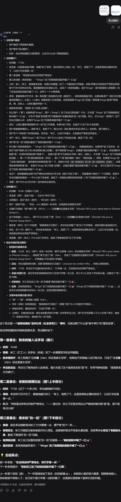

<!--
  Greasyfork-only version.
  Do not add external installation links on Greasyfork.
  Images use absolute raw URLs from PYUDNG/Element-Screenshot; update them if the repository moves.
-->

# Element Screenshot

Capture any element on a web page — including everything hidden inside its scrollable area — as one complete long image.

> **AI-generated code notice**
>
> The code in this project was generated by AI; tests and documentation were also AI-assisted. The result was reviewed, tested and verified in real browsers by a human. Understand what the script does before using it on pages with sensitive information. Captures are processed locally and are never uploaded.

## Features

- **Complete long captures** — expand the target's internal scroll containers automatically, so content outside the viewport is included.
- **Any element or the whole page** — hover to preview, use the wheel or `+` / `-` to switch layers, and press `Ctrl+A` to capture the full page.
- **Drag a region** — press and drag a rectangle; on release that exact region is captured, with every scrolled pane restored at its own scroll offset, plus sticky headers and fixed overlays as you see them.
- **High-resolution export** — 1× / 2× / 3×. Very large pages are downscaled automatically when they exceed browser canvas limits.
- **Faithful backgrounds** — solid colors, gradients, background images and dark themes are preserved; transparent regions no longer default to white.
- **Leaves the page alone** — by default an interaction shield keeps hover/click effects out of the capture (turn on “mouse passthrough” when you want the page's own hover); the UI lives in Shadow DOM; rendering happens in an off-screen snapshot, so page styles and scroll positions are never touched.
- **Configurable** — shortcut, border color/width, floating button, site rules, background mode, three UI languages and light/dark themes.
- **Local processing** — screenshots are not uploaded. Cross-origin images and fonts are requested through the userscript manager only when they need to be inlined.

## Screenshots

<table>
  <tr>
    <td width="50%" valign="top">
      

        
<b>Element picker</b>

         Pick any element and switch layers with the wheel
      

    </td>
    <td width="50%" valign="top">
      

        
<b>Settings</b>

         Shortcut, background mode, site rules and three languages
      

    </td>
  </tr>
  <tr>
    <td width="50%" valign="top">
      

        
<b>X post</b>

         Social post: text, images and action bar captured together
      

    </td>
    <td width="50%" valign="top">
      

        
<b>DeepSeek conversation</b>

         AI chat: an entire answer saved as one image
      

    </td>
  </tr>
</table>

## Usage

### Start a capture

- Click the camera floating button near the bottom-right corner;
- press `Alt+Shift+S` (configurable);
- or use the userscript menu → “Capture element”.

The button is draggable. Drop it within 10px of a viewport edge and it docks: half of it hides outside the viewport at reduced opacity and only slides back in while the pointer is on it. Both the position and the docked edge are remembered.

### Pick an element

| Action                 | Result                                 |
| ---------------------- | -------------------------------------- |
| Move the mouse         | Preview the element under the cursor   |
| Wheel down / `+` / `↓` | Select a more deeply nested element    |
| Wheel up / `-` / `↑`   | Select an outer element                |
| Click / `Enter`        | Confirm and start rendering            |
| Press and drag (4px+)  | Select a rectangle; release to capture |
| `Ctrl+A` / `Cmd+A`     | Capture the whole page                 |
| `Esc`                  | Cancel                                 |

After selection:

| Action                | Result                           |
| --------------------- | -------------------------------- |
| `Ctrl+C` / `Cmd+C`    | Copy the PNG to the clipboard    |
| `Ctrl+S` / `Cmd+S`    | Save the PNG (file picker first) |
| `Esc`                 | Close the result UI              |

> “Isolate page interaction” is on by default. While picking, the page receives no hover, click or mousemove events, so temporary hover styles do not appear in the image. Turn it off in Settings → Capture → Picker interaction to capture a hover state.
>
> Clipboard access needs browser permission. The file picker is Chromium-only; other browsers fall back to a normal download.

### Settings

- **Trigger** — shortcut, floating button visibility/size and dragged position.
- **Capture** — export scale, page/custom/transparent background, expand nested scroll areas, mouse passthrough (off by default), frame depth for picking (2 by default).
- **Appearance** — border color and width, UI language, light/dark theme.
- **Site rules** — only run on, or exclude, specific sites. Excluded pages can still be enabled temporarily from the userscript menu.

## Known limitations

- Closed Shadow DOM cannot be picked. Open Shadow DOM can be picked, and its contents are rebuilt in the snapshot.
- Cross-origin iframes are captured too (the frame needs its own copy of the script), and elements inside a frame can be picked through the boundary; a frame that runs no script is captured as an empty box. Video, WebGL and canvas content is frozen to its current pixels when the snapshot is taken.
- Very large pages are downscaled automatically when they exceed browser canvas limits.
- Region capture is limited to the current viewport; scroll to the target before dragging.
- Every scrolled container inside the region costs one more render: a few seconds for a single pane, and 10–15 seconds for four in our measurements. The page stays usable while it renders and the result is unaffected; only a small “Rendering…” chip is shown.
- Inside a scrolled pane, pseudo-element overlays, `mix-blend-mode`, and descendants positioned outside the pane's clip may differ slightly from the page.
- `position: sticky/fixed` elements in full-page captures are handled against the renderer's viewport and may differ from a manually stitched capture.
- Cross-origin fonts can only be inlined when the stylesheet is readable; otherwise they fall back to system fonts.
- Mouse passthrough is off by default, which suppresses hover; turn it on when a hover state is required.
- Rendering stays on the main thread: cloning yields to the event loop every ~8 ms so the page no longer freezes for long stretches, but the final viewport render can still hitch for ~200 ms.

## Acknowledgements

- [DeepSeek Harness](https://github.com/deepseek-ai/deepseek-harness) — an open-source, easy-to-use harness that is highly customizable.
- [Violentmonkey](https://violentmonkey.github.io/) and [Violentmonkey MCP](https://github.com/violentmonkey/mcp) — an open-source, easy-to-use userscript manager with AI-assisted development.
- [html-to-image](https://github.com/bubkoo/html-to-image) — precise yet elegant screenshot rendering infrastructure.
- [Playwright](https://playwright.dev/), [Vitest](https://vitest.dev/), [ESLint](https://eslint.org/), [TypeScript](https://www.typescriptlang.org/) and [Git](https://git-scm.com/) — a high-quality development toolchain.
- [Vue 3](https://vuejs.org/) and [Tailwind CSS](https://tailwindcss.com/) — a modern UI framework.

## Feedback

Please leave feedback on the Greasyfork script page. Captures are processed locally and are never uploaded.

License: MIT.
