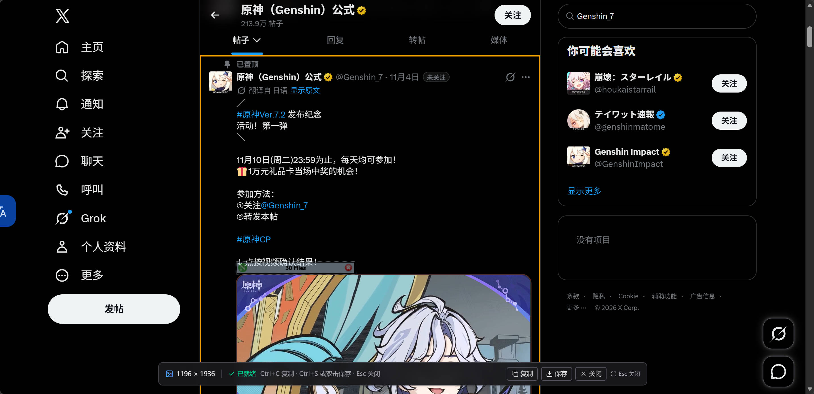
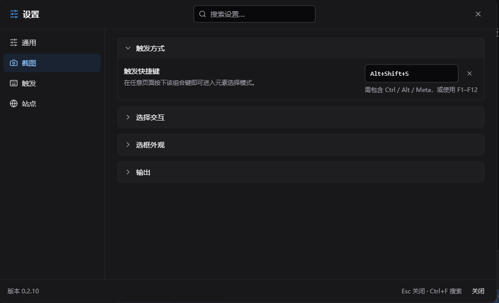
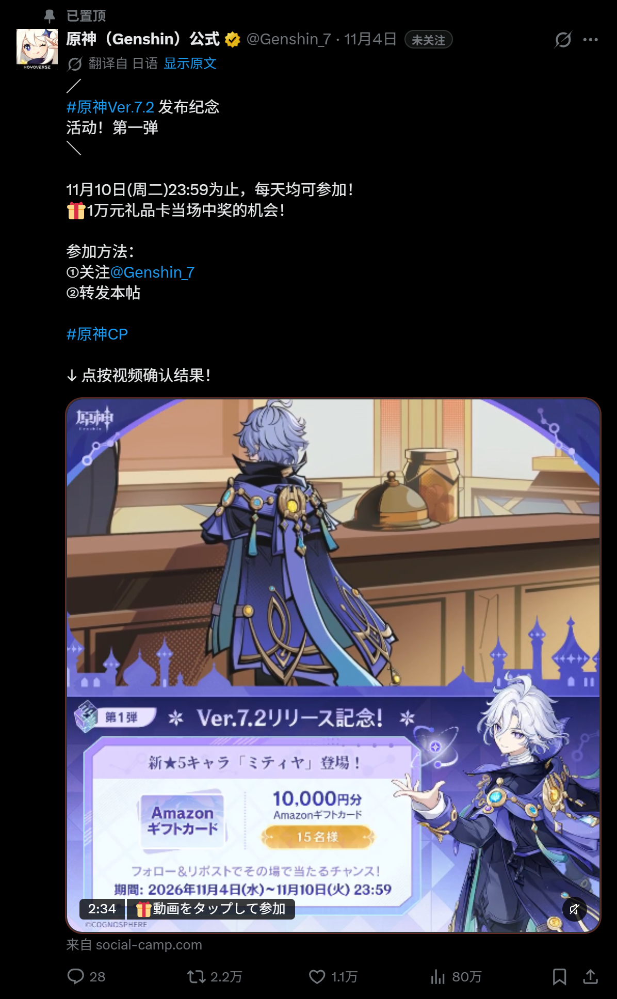
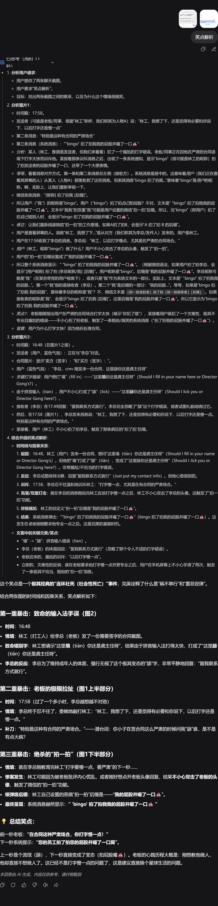

<!--
  Greasyfork 专用版本。
  注意：
  1. 不要在 Greasyfork 页面添加站外安装链接。
  2. 图片使用 PYUDNG/Element-Screenshot 的 raw 绝对地址；仓库迁移时同步更新。
-->

# 网页元素截图 Element Screenshot

一键把网页上的任意元素，连同它被滚动隐藏的内容，完整保存成一张长图。

> **AI 生成代码声明**
>
> 本项目的代码由 AI 生成，测试和文档也由 AI 参与生成，并经过人工审阅、自动化测试和真实浏览器验证。请在理解脚本行为后再用于包含敏感信息的页面；截图只在本机完成，不会上传。

## 功能

- **完整长截图**：自动展开元素内部的滚动区域，把屏幕外被裁掉的内容一起截进来。
- **任意元素或整页**：悬停预选，滚轮或 `+` / `-` 切换层级，`Ctrl+A` 截整页。
- **高清导出**：支持 1× / 2× / 3×；超大页面自动降采样，避免整次截图失败。
- **复杂背景还原**：保留纯色、渐变、背景图和深色主题，不会把透明区域统一填成白色。
- **不干扰页面**：选择时隔离页面交互，UI 放在 Shadow DOM，截图后恢复页面样式和滚动位置。
- **可配置**：快捷键、选框颜色/粗细、悬浮按钮、站点策略、背景模式、三语界面和明暗主题。
- **本地处理**：截图不上传；只有内联跨域图片、字体等资源时，才会向资源原始地址发起请求。

## 效果

<table>
  <tr>
    <td width="50%" valign="top">
      

        
<b>元素选择器</b>

         选择任意元素，滚轮切换层叠层级
      

    </td>
    <td width="50%" valign="top">
      

        
<b>设置面板</b>

         快捷键、背景模式、站点策略和三语界面
      

    </td>
  </tr>
  <tr>
    <td width="50%" valign="top">
      

        
<b>X 帖子</b>

         社交长帖：正文、图片与互动栏一起截取
      

    </td>
    <td width="50%" valign="top">
      

        
<b>DeepSeek 对话</b>

         AI 长对话：整段回答完整保存为长图
      

    </td>
  </tr>
</table>

## 使用

### 触发

- 点击页面右下角的相机悬浮按钮；
- 按 `Alt+Shift+S`（可在设置中修改）；
- 或使用脚本菜单「截图元素」。

### 选择

| 操作                 | 效果             |
| -------------------- | ---------------- |
| 移动鼠标             | 预选鼠标下的元素 |
| 滚轮向下 / `+` / `↓` | 选择更内层元素   |
| 滚轮向上 / `-` / `↑` | 选择外层元素     |
| 单击 / `Enter`       | 确认并开始截图   |
| `Ctrl+A` / `Cmd+A`   | 截取整页         |
| `Esc`                | 取消             |

选中后：

| 操作               | 效果                       |
| ------------------ | -------------------------- |
| `Ctrl+C` / `Cmd+C` | 复制 PNG 到剪贴板          |
| `Ctrl+S` / `Cmd+S` | 保存 PNG（优先文件选择器） |
| 双击页面           | 保存 PNG                   |
| `Esc`              | 关闭结果界面               |

> 默认开启「隔离页面交互」：选择时页面收不到 hover、点击和 mousemove，截图中不会出现临时 hover 样式。需要截取 hover 状态时，在设置 → 截图 → 选择交互中关闭。
>
> 剪贴板需要浏览器授权；文件选择器仅 Chromium 支持，其他浏览器自动回退为普通下载。

### 设置

- **触发**：快捷键、悬浮按钮显示/尺寸、拖动位置。
- **截图**：导出倍率、跟随页面背景/自定义颜色/透明背景、展开内部滚动区域、选择交互隔离。
- **外观**：选框颜色、边框粗细、界面语言（简体中文 / 繁體中文 / English）、明暗主题。
- **站点策略**：仅在指定网站运行，或排除指定网站；被排除的页面仍可从脚本菜单临时启用。

## 已知限制

- Closed Shadow DOM 内部无法点选；Open Shadow DOM 可以选中，但内部内容可能无法完整进入截图。
- 跨域 iframe 内部不可选；视频、WebGL/Canvas 内容依赖当前像素，可能为空白。
- 超大页面会按浏览器 canvas 上限自动降低导出倍率。
- 整页截图中的 `position: sticky/fixed` 元素按渲染器视口处理，可能与逐屏拼接结果不同。
- 跨域字体能否内联取决于样式表是否可读；不可读时会回退为系统字体。
- 默认开启的交互隔离会抑制 hover 效果；需要截 hover 状态时请关闭该开关。

## 致谢

- [DeepSeek Harness](https://github.com/deepseek-ai/deepseek-harness)：开源、好用、高度可自定义的 Harness。
- [Violentmonkey](https://violentmonkey.github.io/) 和 [Violentmonkey MCP](https://github.com/violentmonkey/mcp)：开源、好用、带 AI 开发支持的用户脚本管理器。
- [html-to-image](https://github.com/bubkoo/html-to-image)：实现精密又不失优雅的截图渲染基础设施。
- [Playwright](https://playwright.dev/)、[Vitest](https://vitest.dev/)、[ESLint](https://eslint.org/)、[TypeScript](https://www.typescriptlang.org/)、[Git](https://git-scm.com/)：高质量开发工具链。
- [Vue 3](https://vuejs.org/)、[Tailwind CSS](https://tailwindcss.com/)：现代化的 UI 框架。

## 反馈

请在 Greasyfork 脚本页留言反馈问题。截图只在本机处理，不会上传。

许可：MIT。
