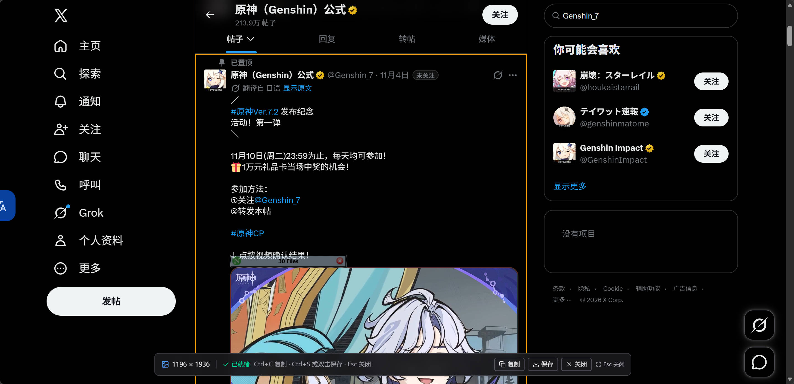
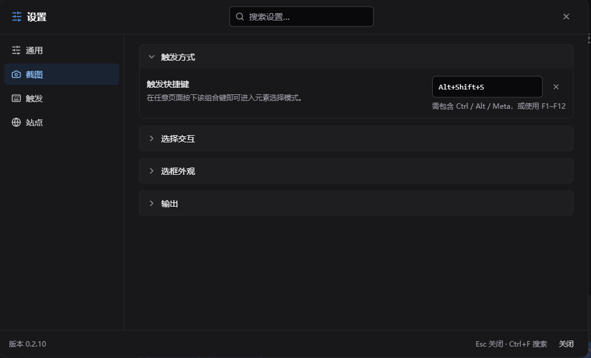
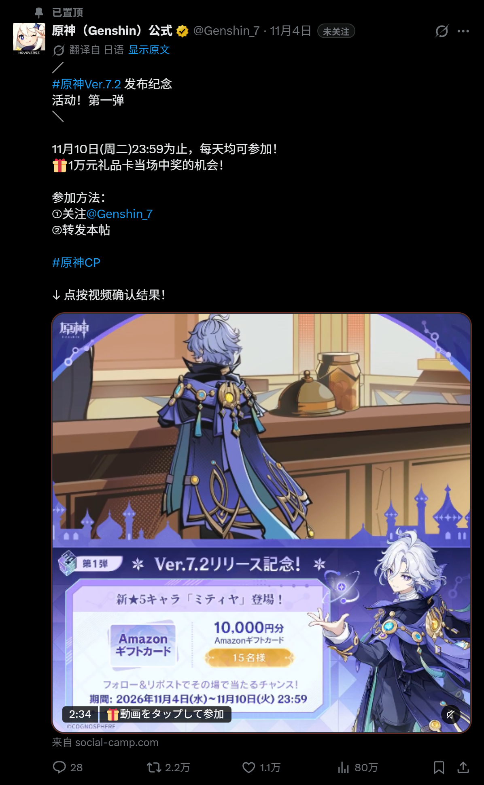
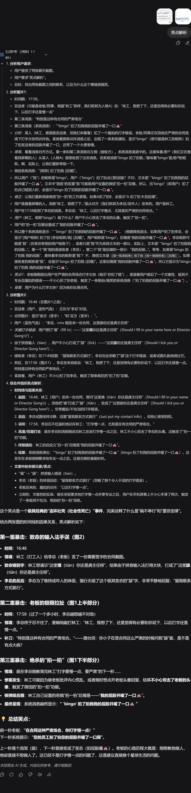

<!--
  Greasyfork 繁體中文版本。
  注意：
  1. 不要在 Greasyfork 頁面加入站外安裝連結。
  2. 圖片使用 PYUDNG/Element-Screenshot 的 raw 絕對網址；倉庫搬家時同步更新。
-->

# 網頁元素截圖 Element Screenshot

一鍵把網頁上的任意元素，連同它被捲動隱藏的内容，完整保存成一張長圖。

> **AI 生成程式碼聲明**
>
> 本專案的程式碼由 AI 生成，測試和文件也由 AI 參與生成，並經過人工審閱、自動化測試和真實瀏覽器驗證。請在理解腳本行為後再用於包含敏感資訊的頁面；截圖只在本機完成，不會上傳。

## 功能

- **完整長截圖**：自動展開元素內部的捲動區域，把畫面外被裁掉的内容一起截進來。
- **任意元素或整頁**：滑鼠懸停預選，滾輪或 `+` / `-` 切換層級，`Ctrl+A` 截取整頁。
- **拖曳框選區域**：按住滑鼠拖出矩形，放開即截取該區域；內部捲動位置、吸頂表頭和固定浮層依目前所見還原。
- **高畫質匯出**：支援 1× / 2× / 3×；超大頁面自動降採樣，避免整次截圖失敗。
- **複雜背景還原**：保留純色、漸層、背景圖和深色主題，不會把透明區域統一填成白色。
- **不干擾頁面**：選取時隔離頁面互動，UI 放在 Shadow DOM，截圖後恢復頁面樣式和捲動位置。
- **可設定**：快速鍵、選框顏色/粗細、懸浮按鈕、站點策略、背景模式、三語介面和明暗主題。
- **本機處理**：截圖不上傳；只有內聯跨域圖片、字型等資源時，才會向資源原始網址發起請求。

## 效果

<table>
  <tr>
    <td width="50%" valign="top">
      

        
<b>元素選擇器</b>

         選取任意元素，滾輪切換層疊層級
      

    </td>
    <td width="50%" valign="top">
      

        
<b>設定面板</b>

         快速鍵、背景模式、站點策略和三語介面
      

    </td>
  </tr>
  <tr>
    <td width="50%" valign="top">
      

        
<b>X 貼文</b>

         社群長貼文：正文、圖片與互動列一起截取
      

    </td>
    <td width="50%" valign="top">
      

        
<b>DeepSeek 對話</b>

         AI 長對話：整段回答完整保存為長圖
      

    </td>
  </tr>
</table>

## 使用

### 觸發

- 點擊頁面右下角的相機懸浮按鈕；
- 按 `Alt+Shift+S`（可在設定中修改）；
- 或使用腳本選單「截圖元素」。

### 選取

| 操作                 | 效果                   |
| -------------------- | ---------------------- |
| 移動滑鼠             | 預選滑鼠下的元素       |
| 滾輪向下 / `+` / `↓` | 選擇更內層元素         |
| 滾輪向上 / `-` / `↑` | 選擇外層元素           |
| 單擊 / `Enter`       | 確認並開始截圖         |
| 按住拖曳（超過 4px） | 框選矩形區域，放開截圖 |
| `Ctrl+A` / `Cmd+A`   | 截取整頁               |
| `Esc`                | 取消                   |

選取後：

| 操作               | 效果                       |
| ------------------ | -------------------------- |
| `Ctrl+C` / `Cmd+C` | 複製 PNG 到剪貼簿          |
| `Ctrl+S` / `Cmd+S` | 儲存 PNG（優先檔案選擇器） |
| 雙擊頁面           | 儲存 PNG                   |
| `Esc`              | 關閉結果介面               |

> 預設開啟「隔離頁面互動」：選取時頁面收不到 hover、點擊和 mousemove，截圖中不會出現臨時 hover 樣式。需要截取 hover 狀態時，在設定 → 截圖 → 選擇互動中關閉。
>
> 剪貼簿需要瀏覽器授權；檔案選擇器僅 Chromium 支援，其他瀏覽器自動回退為一般下載。

### 設定

- **觸發**：快速鍵、懸浮按鈕顯示/尺寸、拖曳位置。
- **截圖**：匯出倍率、跟隨頁面背景/自訂顏色/透明背景、展開內部捲動區域、選擇互動隔離。
- **外觀**：選框顏色、邊框粗細、介面語言（简体中文 / 繁體中文 / English）、明暗主題。
- **站點策略**：僅在指定網站執行，或排除指定網站；被排除的頁面仍可從腳本選單暫時啟用。

## 已知限制

- Closed Shadow DOM 內部無法點選；Open Shadow DOM 可以選取，但內部内容可能無法完整進入截圖。
- 跨域 iframe 內部不可選；影片、WebGL/Canvas 内容依賴目前像素，可能為空白。
- 超大頁面會依瀏覽器 canvas 上限自動降低匯出倍率。
- 區域截圖只在目前視窗內框選，不支援跨螢幕拖曳；請先捲動到目標位置再拖曳。
- 區域同時涵蓋多個獨立捲動面板時，只還原主面板的捲動位置。
- 區域截圖裡，被捲動容器自身的邊框、圓角和陰影依展開後的盒子繪製，可能不在可見邊緣；背景會保留。
- 整頁截圖中的 `position: sticky/fixed` 元素依渲染器視窗處理，可能與逐屏拼接結果不同。
- 跨域字型能否內聯取決於樣式表是否可讀；不可讀時會回退為系統字型。
- 預設開啟的互動隔離會抑制 hover 效果；需要截 hover 狀態時請關閉該開關。

## 致謝

- [DeepSeek Harness](https://github.com/deepseek-ai/deepseek-harness)：開源、好用、高度可自訂的 Harness。
- [Violentmonkey](https://violentmonkey.github.io/) 與 [Violentmonkey MCP](https://github.com/violentmonkey/mcp)：開源、好用、帶 AI 開發支援的使用者腳本管理器。
- [html-to-image](https://github.com/bubkoo/html-to-image)：實現精密又不失優雅的截圖渲染基礎設施。
- [Playwright](https://playwright.dev/)、[Vitest](https://vitest.dev/)、[ESLint](https://eslint.org/)、[TypeScript](https://www.typescriptlang.org/)、[Git](https://git-scm.com/)：高品質開發工具鏈。
- [Vue 3](https://vuejs.org/)、[Tailwind CSS](https://tailwindcss.com/)：現代化的 UI 框架。

## 回饋

請在 Greasyfork 腳本頁留言回饋問題。截圖只在本機處理，不會上傳。

授權：MIT。
